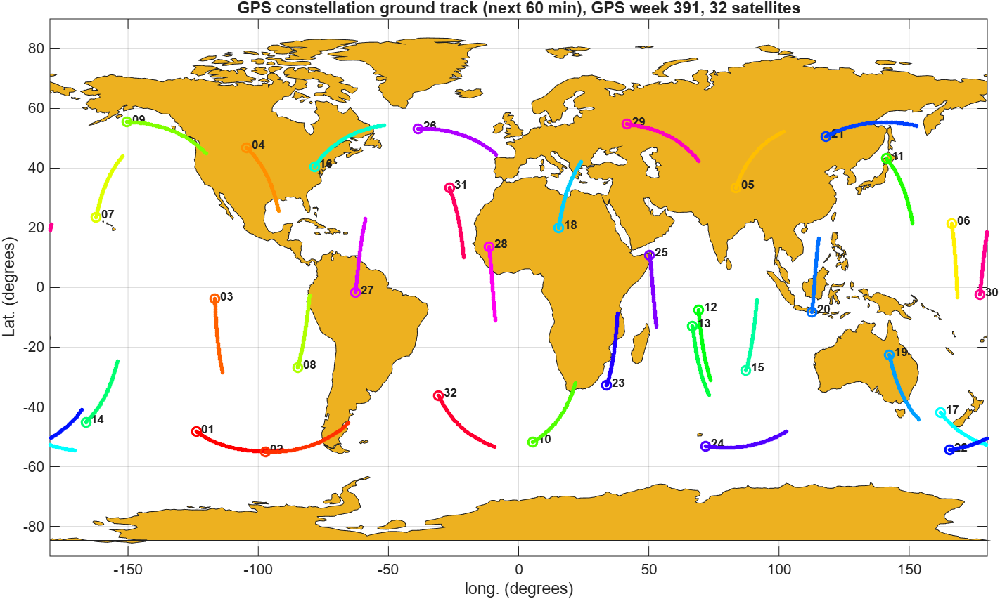
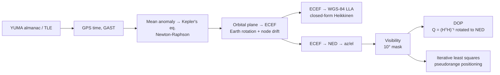
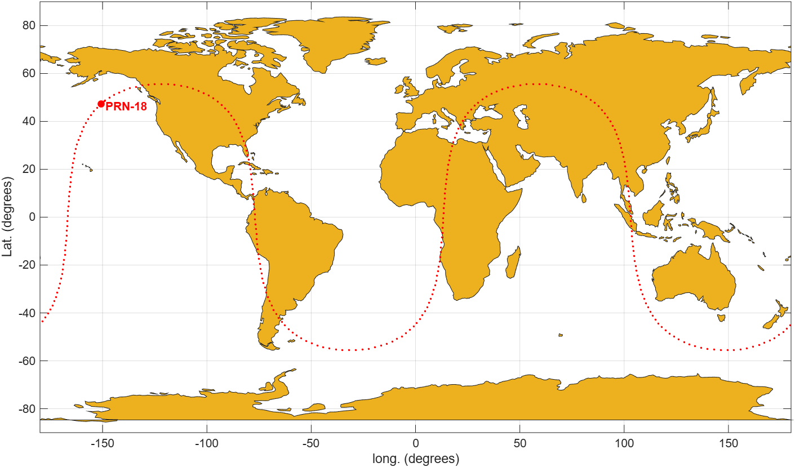
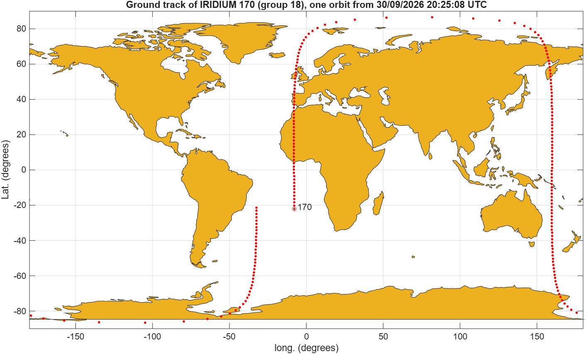
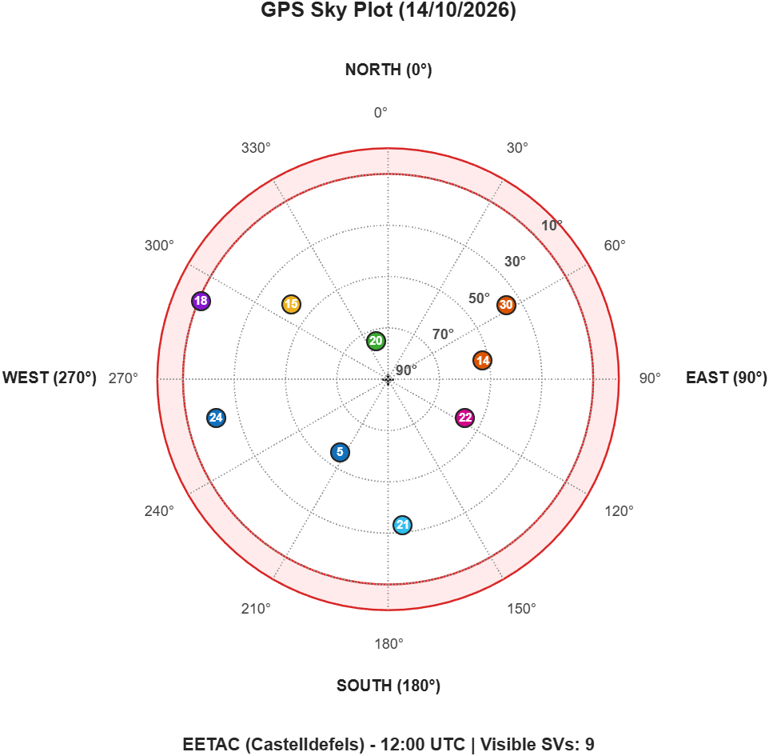
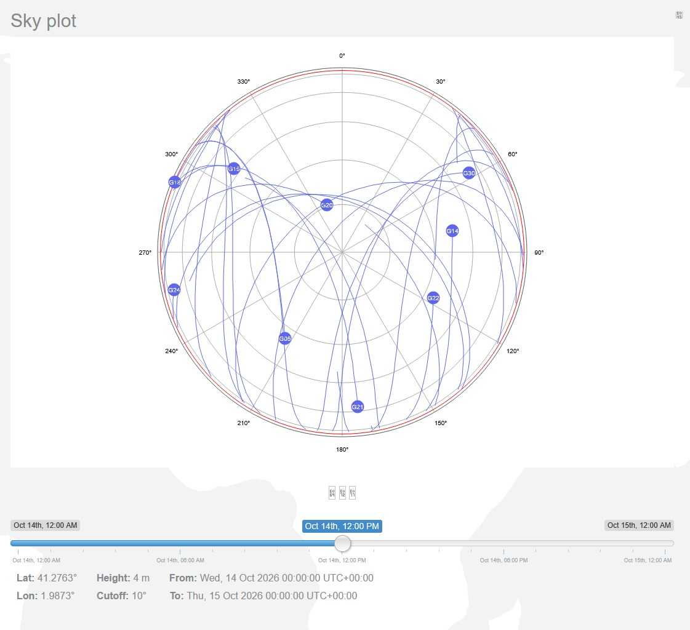
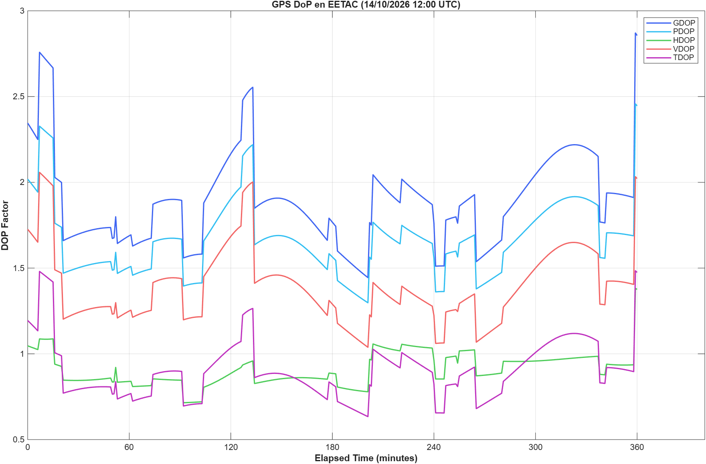
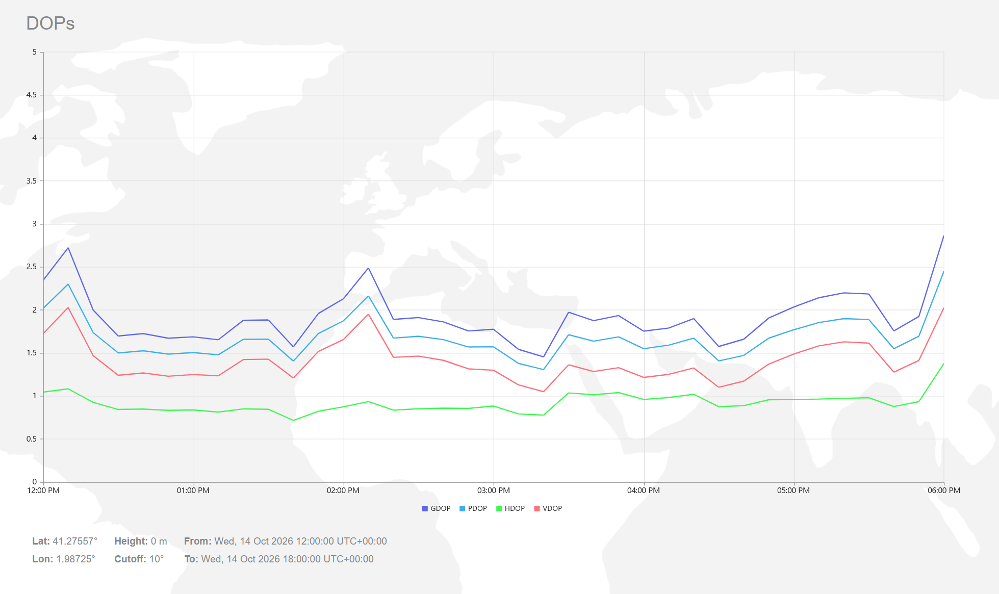
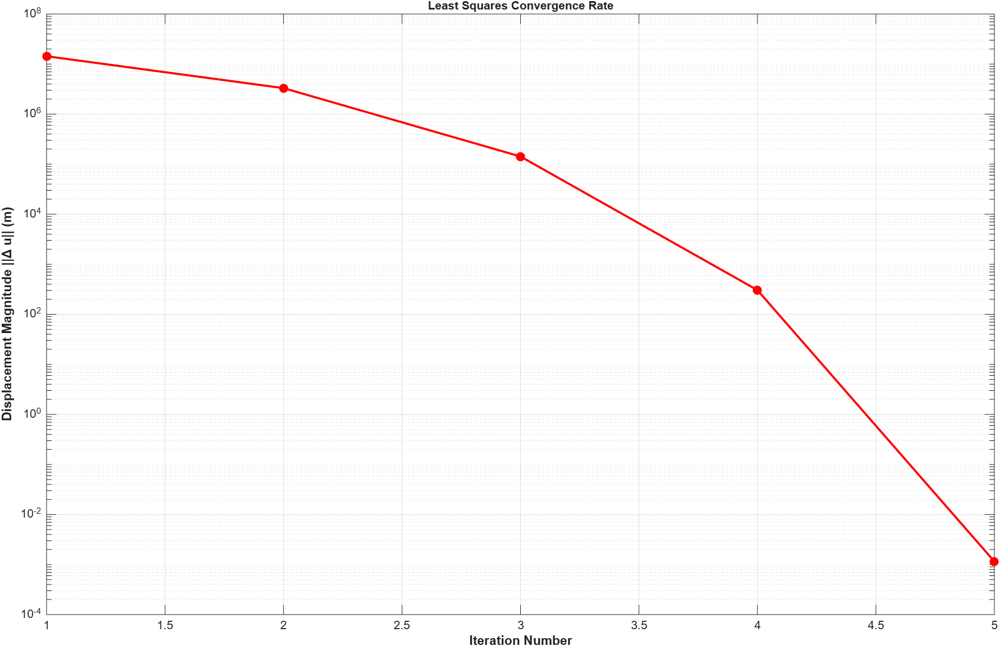

# GNSS from Scratch: Satellite Orbits, Visibility, DOP and Positioning in MATLAB



A self-contained GNSS processing chain written in plain MATLAB (no toolboxes). It goes from raw
broadcast orbital elements (YUMA almanacs and TLEs) to a least-squares receiver position fix. It
was developed for the *Navigation and Satellite Orbit Computation* (NACC) course at EETAC (UPC,
Castelldefels) by Lab Group 18. The results are checked against independent online tools.



## Results at a glance

| Lab | Problem | Key technique | Result |
|-----|---------|---------------|--------|
| 1 | Ground track of GPS PRN-18 over 24 h | Kepler propagation, ECEF, geodetic conversion | 150.65° W, 47.30° N, 20 317 km altitude; two-lobe track reaching ±55.6° |
| 2 | Full GPS constellation (32 SVs) for 1 h, plus one orbit of IRIDIUM 170 from a TLE | YUMA parsing, TLE → Keplerian elements, GAST | Ground tracks for all 32 SVs and for the LEO polar orbit |
| 3 | Satellites in line of sight from EETAC | LLA → ECEF → NED → azimuth/elevation | 9 SVs above 10°; sky plot matches gnssmissionplanning.com |
| 4 | DOP over 6 h, and a position fix from 10 pseudoranges | Geometry matrix, Q′ in NED, Gauss-Newton LS | GDOP 2.35 / PDOP 2.02 / HDOP 1.05 / VDOP 1.73. Fix converges in 5 iterations to −75.9284°, −20.6358°, **h = 4.0 m** (true height 4 m) |

## Lab 1: GPS ground track

 

*Left: PRN-18 over 24 h from the week-390 almanac. Right: IRIDIUM 170 (LEO, i = 86.6°) over one
orbit, propagated from its TLE.*

The target UTC epoch is converted to GPS time. The mean anomaly is propagated from the almanac
Time of Applicability, and Kepler's equation is solved with Newton-Raphson. The in-plane position
is then rotated to ECEF, taking into account Earth rotation and the drift of the ascending node.
The report also measures how the along-track error grows when μ = G·Mₑ is used instead of the
WGS-84 value.

## Lab 3: Line-of-sight coverage

 

*Left: sky plot computed here for EETAC, 14 Oct 2026 12:00 UTC. Right: reference from
gnssmissionplanning.com. All 9 satellites match in azimuth and elevation.*

`main4` also has an interactive mode (`hacer_bucle = true`). It shows 24 h of tracks, a time
slider, and click-to-inspect azimuth, elevation and range.

## Lab 4: Dilution of precision and least-squares positioning

 

*DOP at EETAC for 6 h at 1-min steps (left) against gnssmissionplanning.com (right). The curves
agree to within 0.05 at the tool's sample points.*

Starting from EETAC (Spain), the receiver is relocated to Antarctica, about 13 000 km away. This
takes 5 linearise-and-solve iterations, using only the ten measured pseudoranges:

 

| Iter | ‖Δu‖ (m) | Lat (°) | Lon (°) | Height (m) |
|-----:|---------:|--------:|--------:|-----------:|
| 1 | 14 335 641.94 | −85.188183 | −74.785460 | 3 040 121.48 |
| 2 | 3 304 853.52 | −76.857042 | −22.163342 | 88 481.43 |
| 3 | 142 383.45 | −75.930847 | −20.639599 | 91.94 |
| 4 | 304.29 | −75.928405 | −20.635823 | 4.00 |
| 5 | < 0.01 | −75.928405 | −20.635823 | 4.00 |

## Quick start

Requires MATLAB R2020a or newer (developed and tested on R2026a). No toolboxes are needed, and
everything runs offline with the almanacs in `data/`.

```matlab
cd gnss-matlab
startup                                            % adds src/ to the path
run labs/lab4_dop_ls_positioning/main6.m           % any lab runs from any folder
```

Regenerate every log and figure, then check them against the reference outputs:

```bash
matlab -batch "addpath('tests'); run_labs; r = runtests('tests'); assert(all([r.Passed]))"
matlab -batch "addpath('tools'); export_figures"
```

## Repository layout

```
src/            reusable library, one folder per topic
  config/       gnss_root, gnss_path (data/results folders), gnss_constants
  time/         Julian date, GPS time, GMST/GAST, TLE epoch handling
  orbit/        mean/eccentric/true anomaly, orbital plane, ECEF propagation
  coords/       ECEF↔LLA (Heikkinen closed form; Bowring variant kept), ECEF→NED→az/el
  nav/          DOP (dop, qmat, q2dop) and the LS geometry matrix (reference)
  io/           YUMA almanac download and parsing
  plot/         world map and sky plot
labs/labN_*/    one entry-point script per exercise (main1 … main6)
labs/_template/ starting point for new lab sessions
data/           almanacs, TLEs, pseudorange files, coastline map
results/        figures/ (committed) and logs/ (debug output mainN.dat, generated)
tests/          regression suite against the outputs of the original lab code
tools/          export_figures
docs/reports/   the four lab reports (PDF, IEEE format)
```

### Adding a new lab session
1. Copy `labs/_template/` to `labs/labN_<topic>/` and rename `mainN.m`.
2. Put new reusable functions in the matching `src/` subfolder (or a new one, e.g. `src/signal/`).
   `startup` adds every subfolder automatically.
3. Put input files under `data/` and read them through `gnss_path(...)`, never the current folder.
4. Add the script to `tests/run_labs.m`, store its first output in `tests/baselines/`, and add a
   `testMainN` line to `tests/test_regression.m`.

## Validation
- **Regression:** `tests/test_regression.m` compares every `mainN.dat` line by line with the
  output of the original per-lab code captured before the refactor. main2–main6 are
  byte-identical. main1 now uses the closed-form `ecef2lla` from labs 2–4, which agrees with the
  lab-1 variant to the last printed digit (1e-6°).
- **External checks:** sky plot and DOP are compared with gnssmissionplanning.com. The PRN-18
  ground track is compared with the FAA NSTB satellite status tool (see Lab 1 report).

## Known limitations
- Almanac (not precise ephemeris) orbits, with no clock, ionosphere or troposphere corrections.
  This is suitable for visibility and DOP planning, not for metre-level positioning from real
  measurements.
- The EETAC coordinates differ slightly between labs (height 51 m in `main4`, 4 m elsewhere).
  They are kept as submitted.
- The debug logs use the global file handles `fd`/`fd1`, because the course requires that output
  format.

## Credits
Lab Group 18, NACC, EETAC-UPC (2026). See [CREDITS.md](CREDITS.md) for authors and for the files
provided by the course or by third parties. Reports: [`docs/reports/`](docs/reports).

<details>
<summary>Resumen en español</summary>

Cadena completa de procesado GNSS en MATLAB puro, desarrollada en las prácticas de NACC (EETAC-UPC):
propagación kepleriana a partir de almanaques YUMA y TLE, conversión ECEF/WGS-84/NED, visibilidad
desde la EETAC, cálculo de DOP y posicionamiento iterativo por mínimos cuadrados. Los resultados se
validan con gnssmissionplanning.com y con una batería de pruebas de regresión.
</details>
